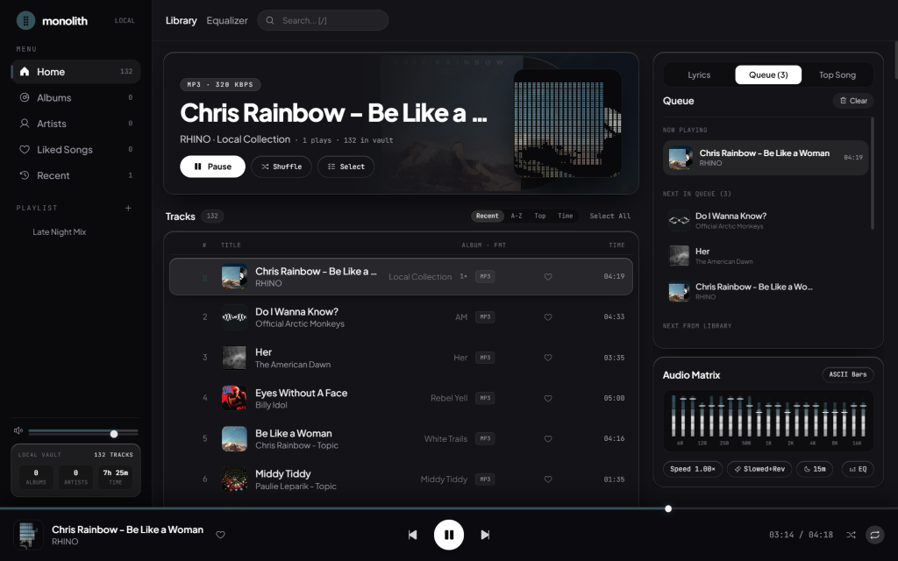
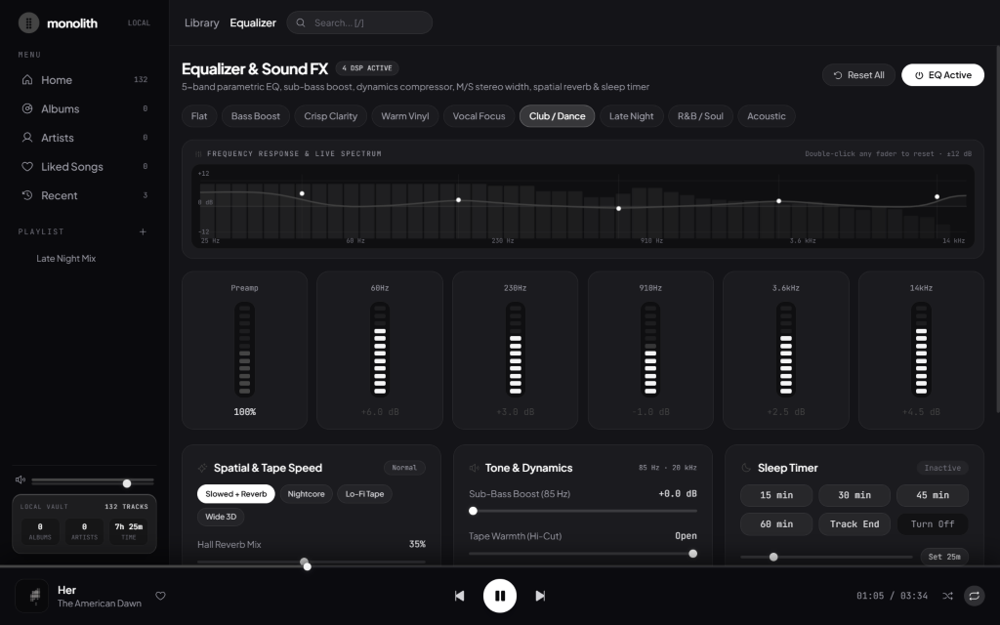

# monolith-audio

Personal offline local music player blending smoked liquid glass with Nothing-inspired ASCII & pixel visualizers, built-in Web Audio DSP, synced karaoke lyrics, and local YouTube Music playlist synchronization.





---

## Features

- **Web Audio DSP & Sound FX**
  - 5-band parametric EQ (`60Hz`, `230Hz`, `910Hz`, `3.6kHz`, `14kHz`) with 9 presets (`Flat`, `Bass Boost`, `Crisp Clarity`, `Warm Vinyl`, `Vocal Focus`, `Club / Dance`, `Late Night`, `R&B / Soul`, `Acoustic`) and live frequency response + spectrum canvas.
  - Preamp gain, Sub-Bass Boost (`85Hz`), Tape Warmth (Hi-Cut lowpass), Dynamics Compressor, Stereo Pan, M/S Stereo Width matrix, and Hall Reverb Convolver.
  - Tape Speed control with quick presets (`Slowed + Reverb`, `Nightcore`, `Lo-Fi Tape`) and Sleep Timer (`15m`, `30m`, `45m`, `60m`, `Track End`, or custom).
- **Glassmorphism & ASCII / Pixel Visuals**
  - 6 cover artwork render modes: `Braille`, `ASCII`, `Dither`, `Halftone`, `Orbit 3D`, and `Original`.
  - 3 real-time audio visualizers: `ASCII Bars`, `Dot Matrix`, and `Oscilloscope`.
  - Reactive WebGL backdrop (`@kawarp/react`) and distraction-free Zen Mode overlay.
- **Zero-Dependency Audio Parser & Synced Lyrics**
  - Custom binary ID3v2.3/2.4 and FLAC metadata/cover art parser (`src/utils/id3.ts`).
  - Supports standard `.lrc` and word-by-word Enhanced LRC karaoke, automatic [LRCLIB](https://lrclib.net) synced lyrics lookup, and per-track lyric timing offsets.
- **Offline YouTube Music Playlist Sync**
  - Per-playlist sync card in the UI communicating with the local Vite bridge and `scripts/sync_playlist.py` (`yt-dlp` + `ffmpeg`).
  - Incremental video-ID deduplication (`yt::<id>`), cancellable progress reporting, HTTP Range streaming from `/inbox/`, and IndexedDB offline caching. See [`scripts/README.md`](scripts/README.md) for setup details.
- **Port-Independent Local Persistence**
  - Playlists, custom covers, Liked Songs, Recent history, play counts, custom lyrics/offsets, metadata overrides, EQ/FX settings, and last playback position are stored inside the project directory (`scripts/app_state.json` and `scripts/playback_state.json`) via `/api/state` and `/api/playback`, keeping your library intact across Vite ports (`5173`, `5174`, etc.) with automatic `localStorage` migration.
- **Local Library & Productivity**
  - Drag-and-drop folders or audio files (`MP3`, `FLAC`, `WAV`, `OGG`, `M4A`, `AAC`, `OPUS`, `WEBM`) and `.lrc` lyrics.
  - Inline playlist renaming, 1:1 custom cover cropping, metadata editor, bulk multi-select actions, queue management, and Command Palette.

---

## Tech Stack

| Layer | Technology |
|---|---|
| **Frontend** | React 19, TypeScript 5.7, Vite 6, Tailwind CSS v4 |
| **UI & Motion** | `motion`, `@phosphor-icons/react`, `@kawarp/react` (WebGL backdrop), Canvas 2D |
| **Audio & Storage** | Web Audio API, `HTMLAudioElement`, Media Session API, IndexedDB, local disk JSON bridge |
| **Playlist Sync** | Vite middleware bridge (`vite.config.ts`), Python 3 stdlib (`scripts/sync_playlist.py`), `yt-dlp`, `ffmpeg`, LRCLIB API |

---

## Getting Started

### Prerequisites

- **Node.js** (18+ recommended) and **npm**
- *(Optional, for YouTube Music playlist sync)* **Python 3**, **`yt-dlp`**, and **`ffmpeg`** (auto-discovered from `PATH` or common Windows WinGet/Scoop/Python Scripts locations)

### Run Locally

```bash
npm install
npm run dev
```

> **Note:** Local bridge endpoints (`/api/*` and `/inbox/*`) are served by Vite (`npm run dev` or `npm run preview`). Running `dist/` on an unrelated static file server disables playlist downloading and disk-backed state sync.

### Build & Preview

```bash
npm run build
npm run preview
```

---

## Keyboard Shortcuts

| Key | Action |
|---|---|
| `Space` | Play / Pause |
| `Ctrl + K` / `Cmd + K` | Toggle Command Palette |
| `/` | Focus search bar |
| `M` | Toggle mute |
| `Z` | Toggle Zen Mode |
| `D` | Cycle cover artwork render mode |
| `V` | Cycle visualizer mode |
| `Esc` | Close active modal, palette, or Zen Mode |

---

## Project Structure

```text
.
├── docs/
│   └── screenshots/        # UI screenshots embedded in README
├── public/
│   └── inbox/              # Local synced MP3s, manifest.json & playlist.json (gitignored)
├── scripts/
│   ├── README.md           # YouTube Music sync & Task Scheduler guide
│   └── sync_playlist.py    # yt-dlp + ffmpeg downloader & LRCLIB lyrics fetcher
├── src/
│   ├── components/         # UI panels, EQ/FX controls, visualizers, Zen Mode, modals
│   ├── hooks/              # Web Audio DSP engine & playback state hook
│   ├── types/              # Shared TypeScript interfaces
│   ├── utils/              # ID3/FLAC/LRC parser, ASCII engine, storage & inbox sync
│   └── App.tsx             # Application shell, library, playlists & shortcuts
├── index.html
├── package.json
└── vite.config.ts          # Vite config + local bridge API (/api/*, /inbox/*)
```

> Personal downloaded audio files (`public/inbox/*`) and local runtime state (`scripts/app_state.json`, `scripts/playback_state.json`, `scripts/downloaded_ids.json`, `scripts/lyrics.json`, `scripts/playlist.txt`, `scripts/sync_status.json`, `scripts/sync.log`) are excluded in `.gitignore`.
